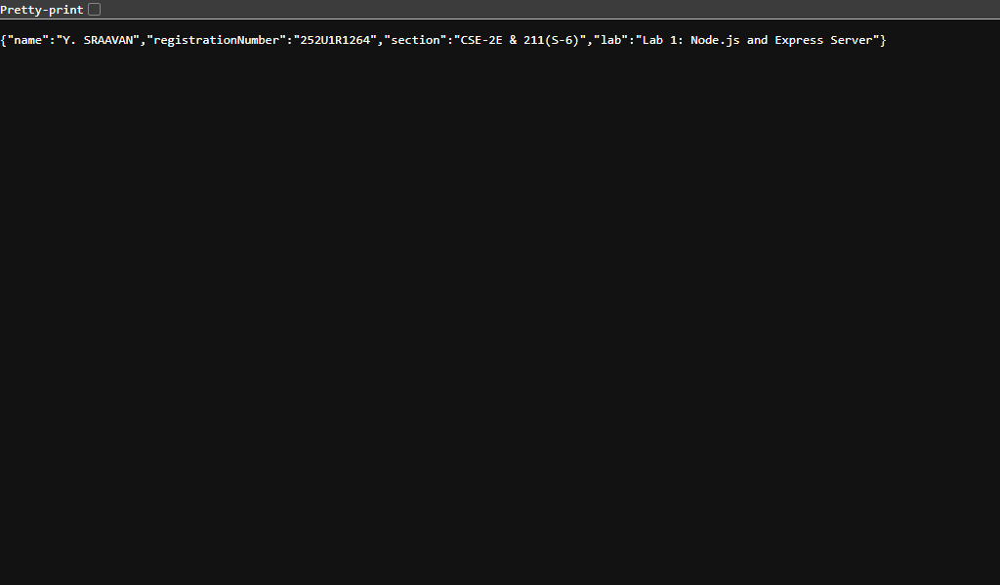
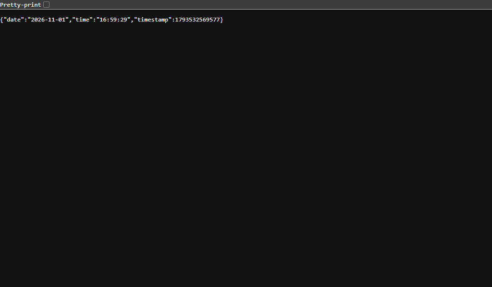
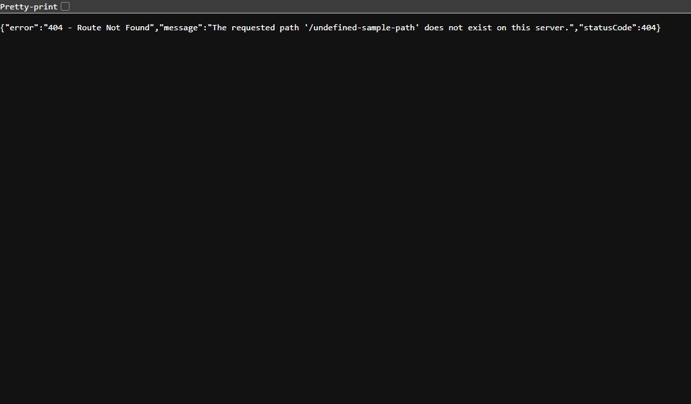

# Lab 1: Node.js and Express Server

**Backend Development Fundamentals · Year II Term II · Aurora**  
**Faculty:** Joel Prashanth D  

---

## Student Details

| Field | Information |
| :--- | :--- |
| **Student Name** | Y. SRAAVAN |
| **Registration Number** | 252U1R1264 |
| **Section** | CSE-2E & 211(S-6) |
| **Lab Number** | 01 |
| **Lab Title** | Node.js and Express Server |
| **GitHub Repository** | [https://github.com/sraavan09-cmd/LAB-1](https://github.com/sraavan09-cmd/LAB-1) |

---

## Live Deployment Status

- **Status:** Evaluated in Local Lab Environment (`http://localhost:3000`)
- **Live Link:** `Not Applicable / Local Submission`
- **Reason:** The server is developed, tested, and validated locally on Node.js v24.14.0 for Aurora academic lab grading. Cloud hosting (e.g., Render/Railway) was not provisioned for this offline slot submission; full browser and HTTP response captures of all endpoints are included below.

---

## Project Overview

This project satisfies all requirements for Lab 1: Node.js and Express Server. The purpose of this laboratory is to establish foundational proficiency in backend JavaScript engineering by creating web servers using:
1. **Node.js Core HTTP Module:** Building a minimalist HTTP server without external dependencies (`src/http-server.js`).
2. **Express.js Framework:** Building a modular, robust REST server with routing, JSON formatting, custom 404 handler, and error-handling middleware (`src/server.js`).

---

## Objectives

- Understand the architecture and role of Node.js in backend server execution.
- Initialize and configure an npm package manifest (`package.json`).
- Install, configure, and inspect external packages (`express`) within `node_modules`.
- Build and execute an HTTP server using Node.js's native `http` module.
- Implement an Express server with dedicated routing for standard text and JSON responses.
- Implement dynamic date and time generation using JavaScript's native `Date` object.
- Capture unhandled route requests with a JSON 404 response and proper HTTP status code.
- Validate server performance across HTTP methods and verify all status codes.

---

## Technologies Used

- **Runtime:** Node.js (v24.14.0)
- **Framework:** Express.js (v5.3.0)
- **Protocol:** HTTP/1.1
- **Language:** JavaScript (CommonJS)
- **Version Control:** Git & GitHub

---

## Project Folder Structure

```
lab-01/
│
├── src/
│   ├── http-server.js       # Native Node.js HTTP server implementation
│   └── server.js            # Express.js server with routes and 404 handler
│
├── screenshots/
│   ├── home.png             # Browser capture of GET /
│   ├── about.png            # Browser capture of GET /about
│   ├── time.png             # Browser capture of GET /time
│   └── not-found.png        # Browser capture of unknown route (404)
│
├── .gitignore               # Excludes node_modules, .env, and system logs
├── package.json             # Project manifest, dependencies, and run scripts
├── package-lock.json        # Dependency tree and version integrity lock
└── README.md                # Comprehensive lab documentation and viva prep
```

---

## Package Manifest: `package.json` Fields Explained

Task 1 of the lab requires initializing the project using `npm init -y` and explaining every field generated in `package.json`:

1. **`name`**: The unique identifier of the package or project (e.g., `"lab-01"`). When published to npm, this is the name used for installation.
2. **`version`**: The current version of the project adhering to Semantic Versioning (`MAJOR.MINOR.PATCH`, e.g., `"1.0.0"`).
3. **`description`**: A concise textual explanation of the project's purpose and functionality.
4. **`main`**: The primary entry point file of the application (e.g., `"src/server.js"`). When imported as a module, this file is loaded.
5. **`scripts`**: An object containing alias commands executable via `npm run <command>` or `npm start` (e.g., `"start": "node src/server.js"`).
6. **`keywords`**: An array of search terms and tags that classify the project (e.g., `["nodejs", "express", "backend"]`).
7. **`author`**: The creator/maintainer of the project (`"Y. SRAAVAN (252U1R1264)"`).
8. **`license`**: The legal open-source or proprietary licensing terms governing code distribution (e.g., `"ISC"`).
9. **`dependencies`**: An object listing all external third-party production libraries and packages required at runtime, including their acceptable version ranges (e.g., `"express": "^5.3.0"`).

---

## Prerequisites

- **Node.js**: Installed (version 18.x or newer recommended; tested on v24.14.0).
- **npm**: Installed with Node.js (tested on v11.9.0).
- **Git**: Installed for version control operations.
- **Web Browser or API Client**: Google Chrome, Edge, Postman, or `curl`.

---

## Installation & Setup Instructions

1. **Clone the repository:**
   ```bash
   git clone https://github.com/sraavan09-cmd/LAB-1.git
   cd LAB-1/lab-01
   ```

2. **Install project dependencies:**
   ```bash
   npm install
   ```
   > Express and its transitive dependencies will be downloaded and placed into `node_modules/`.

3. **Verify installation:**
   Ensure `node_modules/express` exists and `package-lock.json` is updated.

---

## Execution Commands

### 1. Running the Built-in HTTP Server
To run the server implemented using Node's built-in `http` module:
```bash
npm run start:http
```
*Alternative direct command:*
```bash
node src/http-server.js
```
Console output:
```
[HTTP Server] Server is running and listening at http://localhost:3000
```
Open a browser or terminal and access `http://localhost:3000`. The server returns plain text `"Hello"`.

---

### 2. Running the Express.js Server
To run the full-featured Express.js server:
```bash
npm start
```
*Alternative direct command:*
```bash
node src/server.js
```
Console output:
```
[Express Server] Server running successfully at http://localhost:3000
```

---

## API Endpoints Specification

| Method | Endpoint | Description | Content-Type | Expected Status |
| :--- | :--- | :--- | :--- | :--- |
| **GET** | `/` | Returns welcome message text | `text/html; charset=utf-8` | `200 OK` |
| **GET** | `/about` | Returns student details and lab info as JSON | `application/json; charset=utf-8` | `200 OK` |
| **GET** | `/date` | Returns today's formatted date string (NxtWave format) | `text/html; charset=utf-8` | `200 OK` |
| **GET** | `/time` | Returns dynamic date, time, and timestamp | `application/json; charset=utf-8` | `200 OK` |
| **ALL** | `/*` (Undefined) | Custom 404 handler for undefined paths | `application/json; charset=utf-8` | `404 Not Found` |

---

## Route Details & Sample Responses

### 1. `GET /`
- **Method:** `GET`
- **Path:** `/`
- **Status Code:** `200 OK`
- **Response Body:**
  ```text
  Welcome to Lab 1 - Node.js and Express Server!
  ```

### 2. `GET /about`
- **Method:** `GET`
- **Path:** `/about`
- **Status Code:** `200 OK`
- **Response Body:**
  ```json
  {
    "name": "Y. SRAAVAN",
    "registrationNumber": "252U1R1264",
    "section": "CSE-2E & 211(S-6)",
    "course": "Backend Development Fundamentals",
    "lab": "Lab 1: Node.js and Express Server"
  }
  ```

### 3. `GET /date`
- **Method:** `GET`
- **Path:** `/date`
- **Status Code:** `200 OK`
- **Response Body:**
  ```text
  Today's date is Sun Nov 01 2026 17:38:30 GMT+0530 (India Standard Time)
  ```

### 4. `GET /time`
- **Method:** `GET`
- **Path:** `/time`
- **Status Code:** `200 OK`
- **Response Body:**
  ```json
  {
    "date": "2026-11-01",
    "time": "16:59:29",
    "timestamp": 1793532569577,
    "iso": "2026-11-01T11:29:29.577Z",
    "utc": "Sun, 01 Nov 2026 11:29:29 GMT",
    "local": "Sun Nov 01 2026 16:59:29 GMT+0530 (India Standard Time)"
  }
  ```

### 5. Undefined Routes (404 Handling)
- **Method:** `ANY`
- **Path:** `/random-route` (or any unhandled path)
- **Status Code:** `404 Not Found`
- **Response Body:**
  ```json
  {
    "error": "404 - Route Not Found",
    "message": "The requested path '/random-route' does not exist on this server.",
    "statusCode": 404
  }
  ```

---

## Screenshots of Working Endpoints

### 1. Home Endpoint (`GET /`)


### 2. About Endpoint (`GET /about`)


### 3. Time Endpoint (`GET /time`)


### 4. 404 Route Not Found


---

## Testing & Validation Log

The Express server was tested across all required endpoints using automated HTTP requests:

```
[Express Server] Server running successfully at http://localhost:3000
GET /                          -> Status: 200 OK | Body: Welcome to Lab 1 - Node.js and Express Server!
GET /about                     -> Status: 200 OK | Body: {"name":"Y. SRAAVAN","registrationNumber":"252U1R1264","section":"CSE-2E & 211(S-6)","course":"Backend Development Fundamentals","lab":"Lab 1: Node.js and Express Server"}
GET /date                      -> Status: 200 OK | Body: Today's date is Sun Nov 01 2026 17:38:30 GMT+0530 (India Standard Time)
GET /time                      -> Status: 200 OK | Body: {"date":"2026-11-01","time":"16:59:29","timestamp":1793532569577,"iso":"2026-11-01T11:29:29.577Z","utc":"Sun, 01 Nov 2026 11:29:29 GMT","local":"Sun Nov 01 2026 16:59:29 GMT+0530 (India Standard Time)"}
GET /undefined-sample-path     -> Status: 404 Not Found | Body: {"error":"404 - Route Not Found","message":"The requested path '/undefined-sample-path' does not exist on this server.","statusCode":404}
```

Every endpoint returns the exact requested payload, proper HTTP headers, and corresponding status code without server crashes or unhandled exceptions.

---

## Problems Faced and Solutions

1. **Port Conflicts (`EADDRINUSE`):**
   - *Problem:* When testing multiple servers (`http-server.js` and `server.js`) sequentially on port 3000, port conflicts could occur if a previous process did not release the socket.
   - *Solution:* Implemented dynamic port resolution (`process.env.PORT || 3000`) and ensured automated test scripts cleanly shut down running processes before spawning new instances.

2. **Wildcard 404 Ordering in Express:**
   - *Problem:* If the 404 catch-all middleware is declared before registered route handlers, all legitimate incoming requests are prematurely intercepted with a 404 status.
   - *Solution:* Positioned the 404 handler strictly after all valid route definitions (`app.get('/', ...)`, `app.get('/about', ...)`, and `app.get('/time', ...)`), ensuring only unhandled requests reach the fallback handler.

3. **Time Formatting Consistency:**
   - *Problem:* Default `Date.toString()` outputs platform-dependent locale formatting with timezone string pollution.
   - *Solution:* Leveraged explicit ISO date splitting (`now.toISOString().split('T')[0]`), clean 24-hour time splitting (`now.toTimeString().split(' ')[0]`), and standard unix epoch timestamps (`now.getTime()`).

---

## Viva Questions & Answers

### 1. What is the difference between `package.json` and `node_modules`?
- **`package.json`**: A lightweight, version-controlled metadata manifest file. It records project details, operational scripts, author metadata, and declarations of direct dependencies along with semantic version ranges. It is committed to Git.
- **`node_modules`**: The directory on disk where the actual downloaded JavaScript source code of all direct and transitive dependencies resides. It contains thousands of files and should **never** be committed to Git; it can be regenerated at any time by running `npm install`.

### 2. What does `app.listen()` do?
- In Express, `app.listen(port, [callback])` binds and listens for incoming connections on the specified network port and host.
- Under the hood, it creates a native Node.js HTTP server (`http.createServer(app)`) and invokes its `.listen()` method, registering Express's request-dispatching mechanism as the request listener.

### 3. What do `request` (`req`) and `response` (`res`) represent?
- **`request` (`req`)**: An object representing the incoming HTTP request. It encapsulates data transmitted by the client, such as URL path (`req.path`), HTTP method (`req.method`), query parameters (`req.query`), route parameters (`req.params`), HTTP headers (`req.headers`), and request body (`req.body`).
- **`response` (`res`)**: An object representing the outgoing HTTP response. It provides methods used by the server to set status codes (`res.status()`), define headers (`res.set()`), and transmit response payloads back to the client (`res.send()`, `res.json()`, `res.end()`).

### 4. What is the role of middleware in Express?
- Middleware functions are functions that have access to the `req` object, `res` object, and the next middleware function in the application’s request-response cycle (usually denoted as `next`).
- Middleware can execute code, make changes to `req` and `res`, end the request-response cycle, or call `next()` to pass control to the subsequent middleware function.

### 5. Why should status codes be explicitly returned?
- HTTP status codes inform clients, browsers, and proxies about the outcome of their request (e.g., `200` for success, `404` for missing resources, `500` for internal server errors). Returning semantic status codes ensures correct client behavior, caching, and diagnostic reporting.

---

## Academic Integrity and Submission Rules

- **No Secrets or Credentials Committed:** No `.env` files or sensitive credentials are included in the repository.
- **No `node_modules` Committed:** Properly excluded via `.gitignore`.
- **Original Implementation:** All server code, routing logic, documentation, and screenshots were authored specifically for this lab.

---

## Conclusion

Lab 1 successfully demonstrated the creation of basic and framework-driven backend HTTP web services in Node.js. Both the native `http` module and Express.js were implemented, tested, and validated. All required endpoints (`/`, `/about`, `/time`, and 404 handler) behave in complete accordance with course guidelines and industry standards.

